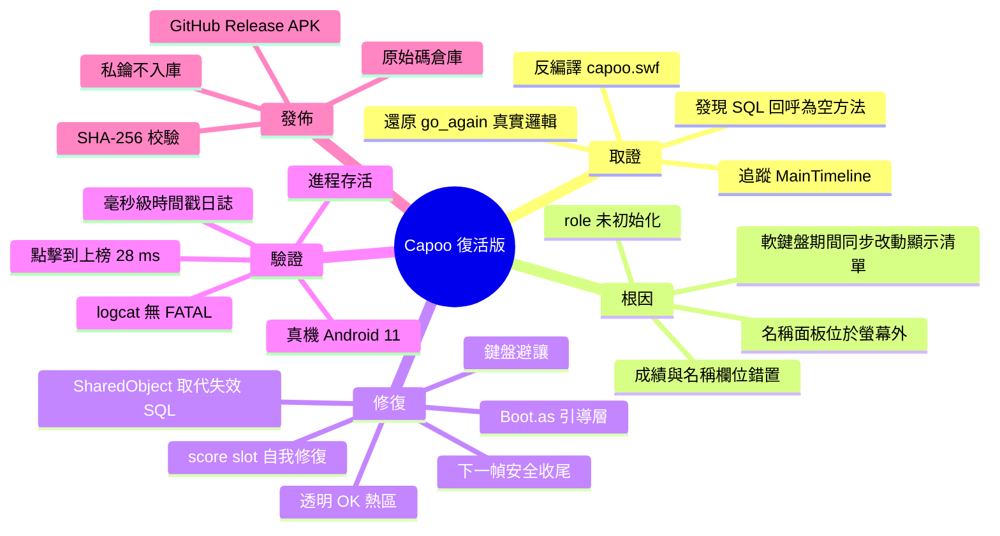
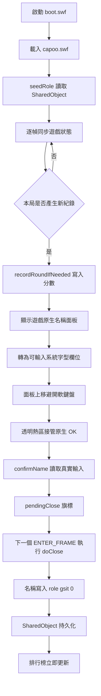
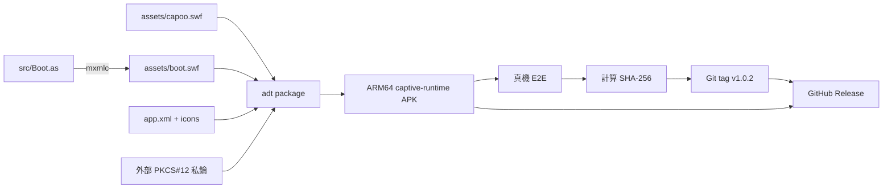

# 復活工程：取證、資料流與修復設計

本文件記錄《Capoo 摸摸手 / Touch Hands》從斷更版本到可在現代 Android 裝置運行的完整復活流程。專案沒有重寫遊戲，而是以 ActionScript 3 引導層修補失效的資料鏈路與輸入流程。

## 專案腦圖



## 問題如何發生

原版的 `role` 是五列 `[名稱, 分數]`。遊戲原先依賴 SQLite 回呼把資料填進陣列，但反編譯顯示 `Query`、`SelectGameDResult`、`AddGameRowResult` 等九個方法只剩三位元組空方法體。於是 `role` 保持 `[undefined, undefined]`，比較、排序、排行榜顯示與成績寫入全部失效。

第二個獨立根因位於 `capoo_fla::彈跳訊息_entername_55.go_again()`：

```actionscript
if (newname.text != "") {
    root["over"] = true;
    this.x = -1000;
    root["role"][root["gsit"]][1] = newname.text;
    root["lastname"] = newname.text;
}
```

名稱被寫入 index `1`（分數）而不是 index `0`（名稱）。同一事件處理器還會在 Android 軟鍵盤仍附著時移走面板並改動焦點，造成 AIR 執行時序錯誤與程序終止。

## 修復後資料流



## 六項核心修復

| 修復 | 實作 | 解決的問題 |
|---|---|---|
| 初始化排行榜 | `seedRole()` | `undefined` 與成績比較失效 |
| 補記本局成績 | `recordRoundIfNeeded()` | 原版要等下一局才寫入 |
| 恢復名稱面板 | `showGameNameClip()` | 面板停在 `x=-609`、永遠不可見 |
| 恢復文字輸入 | `prepareNameField()` | 非 INPUT、嵌入字型缺拉丁字形、文字被遮擋 |
| 接管 OK | `installOkHotspot()` | `go_again()` 把名稱寫進分數格 |
| 安全關閉與自癒 | `pendingClose`、`repairScoreSlot()` | 軟鍵盤崩潰與資料污染 |

## 穩定性不變量

1. 滑鼠與鍵盤事件處理器只記錄意圖，不直接切換時間軸、隱藏 clip 或改焦點。
2. 遊戲原始 `go_again()` 必須保持停用；OK 只走引導層熱區。
3. `role` 的實體順序不可由引導層重排；顯示排序只能操作副本。
4. 未捕捉的 `ErrorEvent.ERROR` 由 stage 攔截並記錄，避免 AIR 錯誤框終止應用。
5. 分數欄若出現字串，立即搬回名稱欄並恢復最後一筆有效分數。

## 建置與發佈流程



簽章私鑰與密碼不得進入倉庫。建置腳本只從 `SIGNING_KEYSTORE` 與 `SIGNING_PASSWORD` 讀取；正式 APK 只放 GitHub Releases，避免 Git 歷史永久膨脹。

## 真機證據

```text
[..045178] panel moved to y=201.5 (lift=true)
[..050327] STAGE down 274.65,488.9 -> HOTSPOT down -> confirm
[..050328] CONFIRM requested name=CaPoo6767
[..050354] NAMED role[0][0]=CaPoo6767
[..050355] closed to menu
```

從點擊到上榜共 28 ms；程序持續存活，`logcat` 未出現 `FATAL`。測試環境為 Redmi Note 10 5G、Android 11、AIR 51.4.1。

## 權利與保存說明

`src/Boot.as` 與建置工具使用 MIT License。`capoo.swf` 與原作美術仍屬原作者；本專案是非官方、非商業的保存與相容性修復，不主張原作內容權利。若權利人提出要求，應優先處理相關資產的下架或替代方案。
